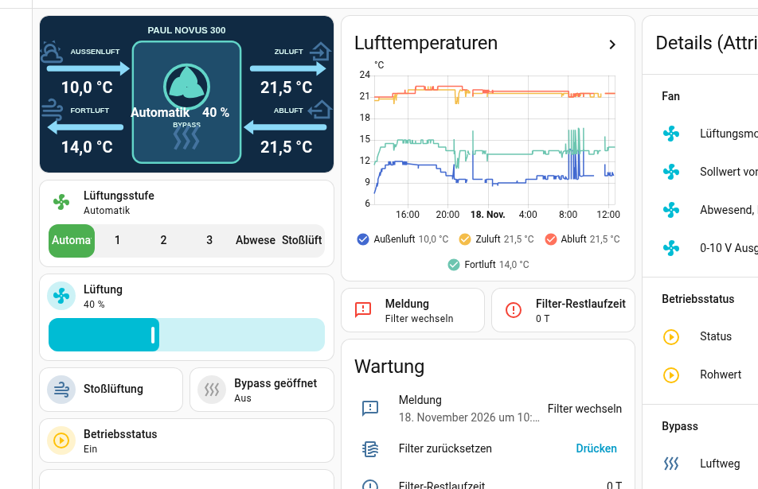
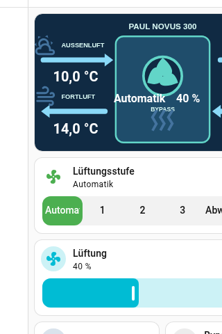

# Paul Novus 300 RS-485 Bus

[](https://github.com/BenPru/novus300_Rs485/actions/workflows/validate.yml)

**English documentation:** [README.md](README.md)

> **XOR-Beta `2026.11.28b1`:** Dieser Zweig ergänzt eine Hardware-/Firmwareprofilwahl
> und passive Unterstützung für das Protokoll aus [Ticket #10](https://github.com/BenPru/novus300_Rs485/issues/10).
> XOR ist **nur lesend**: gewählte Stufe (1-7), Betriebsart (Zu-/Abluft, nur
> Abluft, nur Zuluft, Stoßlüftung), Seitendiagnose und Busuhr. Alle sieben Stufen
> sind nutzerbestätigt; Mitschnitte belegen 1/2/3 sowie 7 bei Stoßlüftung.
> Temperaturen und Schreiben bleiben offen. Getrennt von CRC16/TFT-Beta 2026.11.26b1.
> [Beta installieren und aufzeichnen](docs/DIAGNOSTICS.de.md#xor-beta-20261128b1).


Konfiguration:


Home-Assistant-Integration zum Auslesen und Steuern einer Paul Novus 300 über
RS-485. Sie stellt Temperaturen, Betriebszustand, Luftweg, Filter- und
Betriebszeiten, Meldungen und den Lüftungsmodus bereit und schaltet (über die
`socket://`-Bridge) die Anlage ein/aus und setzt Modus, Stufen und Uhrzeit.

Optional kann sie einen vorhandenen Tinkerforge Industrial Analog Out V2 für
den 0-10-V-Eingang der Anlage als `fan.novus300` einbinden. Diese Ausgabe wird
ausschließlich im Panel-Modus **Automatik** steuerbar. Die RS-485-Schnittstelle
liest fortlaufend und kann nur über die `socket://`-Bridge mit aktivierter
Befehls-Whitelist per `select.novus300_ventilation_mode` einen Lüftungsmodus
anfordern (Automatik, Stufe 1–3, Abwesend, Stoßlüftung).

## Inhalt

- [Getestete Hardware und Kompatibilität](#getestete-hardware-und-kompatibilität)
- [Voraussetzungen](#voraussetzungen)
- [Installation mit HACS](#installation-mit-hacs)
- [RS-485 anschließen und konfigurieren](#rs-485-anschließen-und-konfigurieren)
- [Lüfter ohne 0-10 V](#lüfter-ohne-0-10-v)
- [Optional: Tinkerforge 0-10-V-Lüftersteuerung](#optional-tinkerforge-0-10-v-lüftersteuerung)
- [Optionen (Einstellungsdialog)](#optionen-einstellungsdialog)
- [Anlageneinstellungen](#anlageneinstellungen)
- [Angelegte Entitäten](#angelegte-entitäten) · [Dashboard](#dashboard) · [Automatisierungsbeispiele](#automatisierungsbeispiele)
- [Fehlerdiagnose](#fehlerdiagnose)
- [Neue Hardware mit Diagnosedaten melden](docs/DIAGNOSTICS.de.md)
- [Vorbereitung der passiven Busaufzeichnung](#vorbereitung-der-passiven-busaufzeichnung)
- [HACS-Status und Aufnahme](#hacs-status-und-aufnahme)
- [Uhrzeit-Synchronisation](#uhrzeit-synchronisation)
- [Schreibschutz der Bridge](#schreibschutz-der-bridge)

## Getestete Hardware und Kompatibilität

Stand **28.11.2026**. Getestet sind diese Kombinationen, **nicht pauschal jede
Novus desselben Baujahrs**. Die Baujahre stammen aus Nutzerangaben; zur 2011er
liegen datierte Bauteilaufkleber vor. Profil nach aufgezeichnetem Protokoll
wählen, nicht allein nach Baujahr oder Aussehen des Bedienteils.

| Anlage / Bauteile | Bus und Versionen | Ergebnis |
|---|---|---|
| Novus 300, laut Nutzer 2014, TFT `ETA0036E29A`, Lüfterslave `SWZ0025B26A`, externer PTC-Defroster `ST00064E24A`; Bypass deaktiviert | CRC16-Referenzprofil; Stable 2026.11.21 | **Positiv live getestet:** Temperaturen, Betriebsdaten, Modusrückmeldung und Controllerreaktion auf HA-Stufenwechsel. Panel-Synchronisation weiter offen, siehe Einschränkungen. |
| Zweite Novus 300, laut Nutzer 2014, TFT `ETA0036E30A`, Bypass vorhanden, kein Defroster | CRC16-Referenzprofil; Stable 2026.11.21 | **Positiv live getestet:** Empfang und dekodierte Betriebsdaten. Bypass-Konfiguration/-Status untersucht; direkte Klappensteuerung nicht unterstützt. |
| Novus 300 erster Generation, laut Nutzer 2011, LED-Tastenpanel und Erdwärmetauscher; Waveshare RS232/485/422 TO POE ETH (B), Firmware V1.523 | XOR-Telegramme; tatsächliche Novus-HW/FW unbekannt; [Ticket #10](https://github.com/BenPru/novus300_Rs485/issues/10) | **Negativ mit CRC16**, auch bei dynamischen Adressen. **Positive Stufenrückmeldung:** Nutzer bestätigt alle sieben Stufen mit XOR-Beta 2026.11.24b1; beschriftete Mitschnitte belegen Stufe 1/2 zusätzlich offline. Noch keine Temperaturen oder Schreibzugriffe. |
| Novus 300, Inbetriebnahme Januar 2019, **wahrscheinlich RD, Typenschild noch nicht bestätigt**; TFT Nr. 1 `ETA0036E31E`, Master `SWZ0024B31A`, Lüfterslave `SWZ0025B27A`, elektrischer Defroster `ST00064E26E`; kein Bypass/Nachheizer/EWT; FTDI DSD TECH SH-U14 | CRC16; Panel-Slot `04`, Lüfterslave `08`, Defroster `09`, Freislot-Abfrage `FF`; [Ticket #11](https://github.com/BenPru/novus300_Rs485/issues/11) | **Positiver Empfang gemeldet; alle sechs Mitschnitte offline nachgespielt.** CRC16-Beta 2026.11.26b1 korrigiert Startwerte und gewählten Automatikmodus. **Modusschreiben mit Standard-Bridge funktioniert nicht:** Slot `05` fehlt. Experimentelle externe Schreibzugriffe lösen Vollübertragung und etwa 15 s Statuswechsel aus; Harmlosigkeit ungeklärt. |
| Weitere Novus-300/450-**RD-Kombinationen (redesign)** ab Seriennummernbereich `15000-2`, mit RD-LED- oder TFT-Bedienteil | Protokoll-/Firmwarekompatibilität anderer Kombinationen nicht belegt | **Ungetestet**, kein negatives Testergebnis. Aus dem wahrscheinlichen RD-Beispiel oben keine allgemeine Kompatibilität ableiten. |

`ETA...`, `SWZ...` und `ST...` sind Softwarekennungen der Komponenten, keine
Anlagenseriennummern. **Das angezeigte `BUS 1.7.1` ist eine statische Referenzangabe,
keine unabhängig erkannte Bus-Firmwareversion.** CRC16/XOR bezeichnen
Telegrammaufbau/Prüfsumme, keine nummerierte Hardwaregeneration.
Eine restaurierte Kennung allein beweist kein vorhandenes Bauteil.

**Bauteilgrenzen / bekannte negative Ergebnisse:** PTC-Präsenz und Softwarekennung
wurden beobachtet, ein reiner Busstatus für Heizen/Standby/fehlende Netzversorgung
ist aber nicht belegt. Ein vorhandener Erdwärmetauscher in Ticket #10 bedeutet
noch keine Unterstützung seiner Klappe. Für Sole-Defroster, Nachheizung
und andere Firmwarekombinationen gibt es hier keine positiven
Hardwaretests. Auf der CRC16-Referenzanlage ändern HA-Stufenbefehle die
Controllerrückmeldung und den realen Verbrauch, das TFT kann jedoch bei seiner
alten Auswahl bleiben; ein anderer Teilnehmer kann diese später erneut setzen.
Auch Frostschutzänderungen werden nicht zuverlässig am Panel angezeigt;
die HA-Parameteranzeige allein ist keine Geräterücklesebestätigung.
Deshalb sind nicht pauschal alle Schreibfunktionen als vollständig geprüft anzusehen.

**Getrennte Betas:** [2026.11.28b1](https://github.com/BenPru/novus300_Rs485/releases/tag/2026.11.28b1)
ist die nur lesende LED/XOR-Beta mit experimenteller Zu-/Abluft-, Einlüfter-
und Stoßlüftungsrückmeldung. Alle zwölf Mitschnitte aus Ticket #10 erfolgreich
nachgespielt; Stufen 1/2/3 sowie 7 bei Stoßlüftung sind mit beschrifteten
Rohdaten belegt. Unbekannte Modi bleiben unbekannt; keine gemessenen Luftströme
oder Schreibunterstützung daraus ableiten.
[2026.11.26b1](https://github.com/BenPru/novus300_Rs485/releases/tag/2026.11.26b1)
auf `beta/crc16-rd` ist die CRC16/TFT-Beta, kein XOR-Update. Sie trennt gewählten
Modus (`0x29`) und angewendeten Modus (`0x27`), berücksichtigt Boost als
Überlagerung und liest Startwerte hinter `0x2A`–`0x2D`. Beide Modusrohwerte
stehen in der Diagnose und werden gespeichert. Solange `0x29` noch nicht
beobachtet wurde, bleibt die bisherige `0x27`-Rückmeldung erhalten; restaurierte
Werte sind vorläufig, keine frische Bestätigung. Daraus wird keine gemessene
Lüfterdrehzahl abgeleitet.

Beta installieren: HACS → diese Integration → **Betaversionen anzeigen** →
**Erneut herunterladen** → genaue Version wählen; danach **nur Home Assistant**
neu starten. Für Ticket #11 die Bridge **nur lesend** betreiben
(ohne `--allow-command-frames`); noch keine Schreibautomatik verwenden.
Bridge, Schreibslot, Parität, Einschalttelegramm und Imbalanceskalierung bleiben
unverändert. Die an der Referenzanlage belegten 0,5 % pro Rohschritt bleiben;
für die in Ticket #11 vermuteten 1 % fehlt der Panelvergleich.
Stable/latest bleibt 2026.11.21.

### Neuere Revision: RD / redesign

Zehnders [Anleitungsübersicht](https://zehnder-systems-de.zendesk.com/hc/de/articles/4403739035793-Novus-300-450-Anleitungen)
trennt Serviceunterlagen **V1.0 bis Juni 2015 / Seriennummer 14999** und
**V2.0 ab Oktober 2015 / Seriennummernbereich 15000-2**. Die
[Ersatzteilliste](https://zehnder-systems-de.zendesk.com/hc/de/articles/4409158002705-Novus-Ersatzteilliste)
nennt die neuere Hardware **RD (redesign)** und unterscheidet Master-/Slaveplatinen,
BUS-Thermostate sowie jeweils LED- und TFT-Bedienteile. RD-Ersatzteile sind am
schwarzen Balken auf ihrem Typenschild gekennzeichnet.

| Bedienteil als Ersatzteil | Vor RD | RD |
|---|---|---|
| LED-Tastenpanel | `521010730` | `521014130` |
| TFT-Touchpanel | `521010740` | `521014140` |

Das sind **Artikelnummern**, keine gelesenen Firmwareversionen oder Nachweise
familienübergreifender Austauschbarkeit. Beide dokumentierten Familien führen
beide Paneltypen; damit ist nicht jede Baujahres-/Firmwarekombination belegt.
Der Unterschied 2011 LED/XOR gegenüber 2014 TFT/CRC16 könnte vom Panel,
der Controller-Firmware oder deren Zusammenspiel abhängen;
**„LED = XOR, TFT = CRC16“ ist nicht bewiesen**.
Das sind Hardware-/Serviceunterschiede, **kein Nachweis eines anderen oder
kompatiblen RS-485-Protokolls**; „V2.0“ ist hier keine gelesene Bus-Firmware.
Für die Zuordnung helfen tatsächliche Geräte-/Platinenversionen und ein
[passiver Diagnosemitschnitt](docs/DIAGNOSTICS.de.md).

## Voraussetzungen

- Home Assistant mit HACS
- Paul Novus 300 mit zugänglicher RS-485-Service-/Bus-Schnittstelle
- Ein für die Schnittstelle geeigneter RS-485-Adapter oder ein separater
  seriell-zu-TCP-Reader
- Optional für `fan.novus300`: Tinkerforge Master/Bricklet-System mit
  **Industrial Analog Out V2**, Brick Daemon und Netzwerkzugriff

> [!WARNING]
> Arbeiten an der Lüftungsanlage und ihrer Busverkabelung erfolgen auf eigene
> Verantwortung. Anlage spannungsfrei schalten, bevor Leitungen angeschlossen
> oder verändert werden. Anschlussbelegung, zulässige Leitungslänge und
> Abschlusswiderstände immer dem Paul-Handbuch und dem konkreten Anlagentyp
> entnehmen. CRC16-Schreibzugriffe benötigen die projektspezifische busbewusste
> Bridge samt Befehls-Whitelist; ein generischer transparenter TCP-Konverter
> ersetzt deren Schreibzeitplanung nicht. XOR bleibt nur lesend.

## Installation mit HACS

[](https://my.home-assistant.io/redirect/hacs_repository/?owner=BenPru&repository=novus300_Rs485&category=integration)
[](https://my.home-assistant.io/redirect/config_flow_start/?domain=novus300bus)

Der erste Button öffnet dieses Repository in HACS deiner Home-Assistant-Instanz.
Die Integration herunterladen und Home Assistant neu starten; anschließend
startet der zweite Button die Einrichtung. Beide Buttons nutzen My Home Assistant.

Alternativ manuell installieren und einrichten:

1. In HACS **Integrationen** öffnen.
2. Über das Drei-Punkte-Menü **Benutzerdefinierte Repositorys** wählen.
3. `https://github.com/BenPru/novus300_Rs485` eintragen und als Kategorie
   **Integration** auswählen.
4. Die Integration herunterladen und Home Assistant neu starten.
5. Unter **Einstellungen → Geräte & Dienste → Integration hinzufügen** nach
   **Paul Novus 300 RS-485 Bus** suchen.

Die Konfiguration erfolgt vollständig über die Oberfläche; YAML für die
RS-485-Integration ist nicht erforderlich.

## RS-485 anschließen und konfigurieren

### Direkter USB-RS-485-Adapter

1. Einen Adapter verwenden, dessen UART **MARK-Parität** bei 9600 Baud
   unterstützt. In Home Assistant immer den stabilen Gerätenamen
   `/dev/serial/by-id/...` verwenden, nicht `/dev/ttyUSB0`.
2. Den Adapter bei ausgeschalteter Anlage an die dafür vorgesehene RS-485-
   Schnittstelle anschließen:
   - `A`/`D+` des Adapters an `A`/`D+` der Anlage,
   - `B`/`D-` des Adapters an `B`/`D-` der Anlage,
   - Signalmasse nur dann verbinden, wenn sie im Paul-Schaltbild vorgesehen
     ist.
3. Keine eigene Busversorgung einspeisen und keine Abschlusswiderstände
   hinzufügen, sofern dies nicht explizit in der Anlagendokumentation verlangt
   wird.
4. In der Integration als serielles Gerät den `/dev/serial/by-id/...`-Pfad,
   **9600** Baud und die Parität **mark** auswählen.

Werden keine Werte empfangen, zuerst A und B gemäß Anlagendokumentation prüfen.
Leitungsfarben sind nicht genormt; A/B nicht anhand der Farbe zuordnen.

### Seriell über TCP

Die RS-485-Schnittstelle kann auch an einem separaten Rechner gelesen und dort
als TCP-Stream bereitgestellt werden. Das trennt die physische
Busanbindung vom Home-Assistant-Host.

- Der serielle Reader verarbeitet auf seiner lokalen UART-Seite 9600 Baud mit
  MARK-Parität.
- In der Integration `socket://<host>:<port>` eintragen, beispielsweise
  `socket://192.0.2.45:9700`.
- Für TCP in der Integration die Parität **none** wählen: Die Parität wurde
  bereits vom seriellen Reader verarbeitet.

Der eingesetzte TCP-Reader muss nur einen Client zulassen oder Zugriffe
serialisieren. Eine zweite parallele Verbindung kann die bestehende
Home-Assistant-Verbindung trennen.

## Lüfter ohne 0-10 V

`fan.novus300` ist immer verfügbar und zeigt den Prozentwert der aktiven Stufe. Mit 0-10 V wählt das Setzen eines Prozentwerts Automatik und schreibt ihn per Tinkerforge. Ist die 0-10-V-Steuerung deaktiviert, steuert die Entität die Anlage über den Bus: Ein Soll unter Stufe 2 wählt Stufe 1 und setzt deren Prozentwert auf das Soll (mind. 17 %), über Stufe 2 entsprechend Stufe 3; Soll gleich Stufe 2 wählt Stufe 2. Die ursprünglichen Prozentwerte von Stufe 1/3 werden gemerkt und beim Verlassen der Stufe (auch nach Neustart) zurückgeschrieben.

## Optional: Tinkerforge 0-10-V-Lüftersteuerung

Die RS-485-Auslesung funktioniert ohne Tinkerforge. Dieser Abschnitt ist nur
für die zusätzliche Entität `fan.novus300` erforderlich.

### Tinkerforge vorbereiten

1. Den **Industrial Analog Out V2** mit dem Tinkerforge-Stack verbinden und
   dessen UID mit Brick Viewer ermitteln.
2. Brick Daemon auf dem Rechner/Gateway betreiben, der/das den Tinkerforge-
   Stack erreicht. Der Standardport ist `4223`.
3. Vom Home-Assistant-Host die TCP-Verbindung zu `<tinkerforge-host>:4223`
   erlauben.
4. In den Integrationsoptionen **0-10-V-Lüftersteuerung aktivieren** sowie
   Host, Port und UID eintragen.

### 0-10-V-Ausgang anschließen

1. Anlage und Tinkerforge-Hardware vor dem Verdrahten spannungsfrei schalten.
2. Den Ausgang `OUT` des Industrial Analog Out V2 mit dem in der
   Paul-Dokumentation bezeichneten **externen 0-10-V-Steuereingang** verbinden.
3. `GND` des Analogausgangs mit der dazugehörigen Signalmasse des
   Steuereingangs verbinden. Nicht mit RS-485 A/B verbinden.
4. Zulässige Spannungen, Massereferenz und mögliche galvanische Trennung der
   Paul-Anlage vor dem Einschalten anhand der Herstellerunterlagen prüfen.
5. Die Ausgabe zunächst mit 0 % testen und erst danach geringe Werte setzen.

`fan.novus300` liest beim Start die aktuell ausgegebene Spannung. Schreiben
ist nur möglich, wenn das Lüftungspanel auf **Automatik** steht. Bei
Panel-Stufe 1–3, Stoßlüftung, Abwesend oder Standby ist die Entität bewusst
schreibgeschützt.

Die Schaltfläche `button.novus300_boost` fordert den Panel-Modus
**Stoßlüftung** auf dem RS-485-Bus an und stellt nach der konfigurierten Dauer
den vorherigen Modus wieder her, sofern die Anlage noch in Stoßlüftung steht.

Wenn der konfigurierte Automatik-Helfer vorhanden ist, bietet `fan.novus300`
zusätzlich die Presets **Automatik** und **Manuell**. Sie schalten ausschließlich
diesen Helfer und sind ebenfalls nur bei Panel-Modus Automatik verfügbar.

## Optionen (Einstellungsdialog)

Öffnen über **Einstellungen → Geräte & Dienste → Paul Novus 300 RS-485 Bus → Zahnrad**, dann die Einstellungsgruppe wählen. Die allgemeinen Einstellungen nennen noch nicht empfangene Werte. Beim Speichern werden Anlagenwerte über die Bridge geschrieben (Befehls-Whitelist erforderlich).

| Feld | Bedeutung | Werte / Standard |
|---|---|---|
| **Serielles Gerät / Bridge-URL** | RS-485-Verbindung: Gerätepfad (`/dev/serial/by-id/...`) oder `socket://Host:Port` der seriellen Bridge. Schreiben (Modus, Ein/Aus, Einstellungen, Uhrzeit) geht nur über die Bridge, die mit `--allow-command-frames` gestartet wurde. | `/dev/ttyNovus300` |
| **Baudrate** | Busgeschwindigkeit. | 9600 |
| **Parität** | Physische UART-Einstellung; `socket://` konfiguriert den entfernten Konverter nicht. | Profil-/adapterabhängig: Referenz-Schreibbridge mit MARK; XOR-Empfang aus Ticket #10 mit 8N1. |
| **Dynamische Bus-Adressen akzeptieren (experimentell)** | Bei Einrichtung oder unter **Neu konfigurieren → Schnittstelle: RS-485-Bus**: akzeptiert zusätzlich CRC-gültige Empfangsframes mit abweichendem ersten Headerbyte (bisher nur `00/01`). Das zweite Headerbyte ist bereits uneingeschränkt. Schreibziele, Bus-Timing und Registerdekodierung bleiben unverändert; keine automatische Gerätezuordnung. Kein belegter Fix für Issue #10. | aus |
| **Uhrzeit täglich synchronisieren** | Setzt Datum und Uhrzeit der Anlage täglich um 03:00 auf die Zeit von Home Assistant und prüft die Abweichung. | an |
| **Lüftungsstufe 1 / 2 / 3 (%)** | Lüfter-Prozentwert der drei Stufen, wird in die Anlage geschrieben. Es muss gelten: 17 % ≤ Stufe 1 < Stufe 2 < Stufe 3 ≤ 100 %, sonst zeigt der Dialog einen Fehler. Zeigt den ursprünglichen Wert, auch wenn gerade ein Prozentwert Stufe 1 oder 3 vorübergehend überschreibt. | 35 / 60 / 90 % |
| **Stufe 1 / 2 / 3: Disbalance (%)** | Separate Feineinstellung gemeinsam mit jeder Stufe gruppiert. Empfangene Werte werden gemerkt; unbekannte Werte bleiben leer und werden ohne Eingabe nicht geschrieben. | −50 bis +50 %, Schritt 0,5 |
| **Dauer Stoßlüftung** | Wie lange die Stoßlüftung nach `button.novus300_boost` läuft. Auswahl in 5-Minuten-Schritten (5–120). | 15 min |
| **Abwesend: Lüftungszeit (min/h)** | Lüftungsminuten pro Stunde auf Stufe 1 im Modus Abwesend. | 15 / 30 / 45, Standard 30 |
| **Stufen statt Automatik anzeigen, wenn der Lüfter per Prozent gesteuert wird** | Aus: Die Modus-Auswahl bleibt auf *Automatik*, solange `fan.novus300` einen Prozentwert setzt. An: Sie zeigt Stufe 1 oder 3. | aus |
| **Filterintervall** | Wechselintervall, wird in die Anlage geschrieben und beim Filter-Reset verwendet. Auswahl 30–180 Tage in 10er-Schritten. | 90 Tage |
| **0-10 V: Lüftersteuerung aktivieren** | Optionaler Hardware-Weg über ein Tinkerforge Industrial Analog Out V2 (siehe unten). Für die Bus-Steuerung nicht nötig. | aus |
| **0-10 V: Tinkerforge-Host / -Port / UID** | Adresse des Tinkerforge-Brick-Daemons und UID des Analog-Out-Moduls. | `10.0.17.45` / 4223 / `Hob` |
| **0-10 V: Helfer-Entität für Automatikmodus** | `input_boolean`, die den Automatikmodus für den 0-10-V-Ausgang markiert. | `input_boolean.luftung_automatik` |

Hinweise:
- Werte, die die Anlage selbst sendet (Menüänderungen am Bedienteil), werden automatisch in die Optionen übernommen.
- Beim Speichern werden vorübergehende Stufen-Überschreibungen (Lüfter-Prozentwert) verworfen und die ursprünglichen Stufen wiederhergestellt.
- Eine Änderung des Filterintervalls wird ebenfalls in die Anlage geschrieben.

## Anlageneinstellungen

Diese Werte liegen in der Anlage. Die Lüftungsstufen sind normale Zahlenfelder
(17–100 %, aufsteigende ganze Zahlen); die Zeiten sind Auswahllisten:

| Einstellung | Schrittweite der Anlage | Standardwert |
|---|---|---:|
| Lüftungsstufe 1 / 2 / 3 | ganze Prozentwerte, 17–100 % | 35 / 60 / 90 % |
| Disbalance Stufe 1 / 2 / 3 | −50 bis +50 %, Schritt 0,5 | Anlagenwert; leer, solange unbekannt |
| Dauer Stoßlüftung | 5 min | 15 min (Werk) |
| Abwesend: Lüftungszeit | 15 / 30 / 45 min/h | 30 min/h |

Das Filterintervall (30–180 Tage, 10-Tage-Schritte) ist eine Auswahlliste in den Optionen und wird beim Speichern in die Anlage geschrieben. `button.novus300_filter_reset` und der Dienst `novus300bus.reset_filter` setzen die Filterlaufzeit zurück (beide Register auf das eingestellte Intervall).

Beim Speichern der allgemeinen Einstellungen werden Stufen-/Zeitwerte und ausgefüllte Disbalance-Werte über die RS-485-Bridge geschrieben. Für Disbalance-Schreiben `tools/novus300_serial_bridge.py` auf dem Bridge-Rechner aktualisieren; fremde Register und ungültige Bereiche bleiben gesperrt.

Die Anlage sendet die Einstellungen nur selten (ein Register alle paar Minuten im langsamen Wechsel, nicht direkt beim Start); sie werden automatisch in die Optionen übernommen, sobald sie gesehen wurden; die Integration
merkt sich die zuletzt auf dem Bus gesehenen Werte (Speichern am Bedienteil) und
bietet sie als Vorgabe an. Stoßlüftung und Abwesend haben am Bedienteil keinen
Prozentwert. Stoßlüftung hat eine Dauer; Abwesend ist die Lüftungszeit pro
Stunde (min/h) auf Stufe 1 als Feuchteschutz. `fan.novus300` verwendet beim Einschalten
**Lüftungsstufe 2**; die Stoßlüftungs-Schaltfläche startet die Stoßlüftung der
Anlage für die eingestellte **Dauer Stoßlüftung**. Bei Standby, Stoßlüftung und
Abwesend zeigt die Lüfteransteuerung den Rohwert des Busses.

### Sommerlüftung und Bypass

Die Aktivierung der Sommerlüftung erfolgt über `switch.novus300_summer_ventilation`, nicht mehr über eine Checkbox in den Optionen. Der Schalter wird nur bei bestätigt **ohne Bypass** konfigurierter Anlage angeboten; manuelles Deaktivieren der Entität wird respektiert. Bei vorhandenem Bypass wird stattdessen dessen lesende Rückmeldung aktiviert. `switch.turn_on` / `switch.turn_off` sind in Automationen nutzbar. Es wird nur Bit `0x80` der bekannten Anlagenkonfiguration geändert; unbekannte Konfiguration oder fehlende Busbestätigung führen zu einem Fehler statt zu einem vermeintlichen Erfolg.

Das aktiviert die Sommerlüftungsfunktion der Anlage, **erzwingt aber kein Öffnen oder Schließen der Bypass-Klappe**. `switch.novus300_bypass` bleibt eine reine Rückmeldung. Ein belegter direkter Stellbefehl fehlt weiterhin; die physische Klappenbewegung ist nicht getestet. Bypass-Installation und Temperaturschwellen bleiben in den Optionen.

## Angelegte Entitäten

Vollständige Liste mit allen Attributen: [docs/ENTITIES.de.md](docs/ENTITIES.de.md).

### Dashboard

[`dashboards/novus300.yaml`](dashboards/novus300.yaml) ist ein fertiges Dashboard (nur Standard-Karten, mit Karte „Details (Attribute)“ und Liste der Statuswechsel). Die Grafik liefert die Integration selbst aus (unter `/novus300bus/novus300-airflow.svg`), es muss nichts nach `config/www/` kopiert werden. Kurz: neues Dashboard anlegen → Rohkonfigurationseditor → Inhalt der Datei einfügen. **Ausführliche Schritt-für-Schritt-Anleitung (mit Varianten, Prüfung und Fehlerbehebung): [docs/DASHBOARD.de.md](docs/DASHBOARD.de.md).**

Enthalten sind **Übersicht** (Bedienung und Luftstrom) und **Sensoren** (zweites Anlagenschema mit Sensorpositionen und ausstattungsabhängigen Ebenen). Die Anleitung beschreibt außerdem das zweite **editierbare UI-Dashboard** neben dem YAML-Dashboard und die voneinander unabhängige Aktualisierung beider Kopien.



Die Modus-Tasten heben die aktive Stufe hervor; die Kacheln für Stoßlüftung, Meldung und Filter werden nur bei Bedarf farbig eingeblendet:



Verwendete Entitäten (alle von dieser Integration): `select.novus300_ventilation_mode`, `fan.novus300`, `button.novus300_boost`, `switch.novus300_power`, `switch.novus300_bypass`, `sensor.novus300_message`, `button.novus300_filter_reset` sowie die Temperatur- und Filtersensoren.

#### Automatisierungsbeispiele

```yaml
# Sommerlüftung nach Zeitplan, nur ohne konfigurierten Bypass
automation:
  - alias: "Novus: abends Sommerlüftung"
    triggers:
      - trigger: time
        at: "21:00:00"
    conditions:
      - condition: state
        entity_id: switch.novus300_summer_ventilation
        state: "off"
    actions:
      - action: switch.turn_on
        target:
          entity_id: switch.novus300_summer_ventilation

# Stoßlüftung bei hoher Luftfeuchtigkeit im Bad
  - alias: "Novus: Stoßlüftung bei Feuchte"
    triggers:
      - trigger: numeric_state
        entity_id: sensor.bad_luftfeuchtigkeit
        above: 70
    actions:
      - action: button.press
        target:
          entity_id: button.novus300_boost

# Abwesend, wenn niemand zu Hause ist, sonst Automatik
  - alias: "Novus: Modus nach Anwesenheit"
    triggers:
      - trigger: state
        entity_id: group.family
    actions:
      - action: select.select_option
        target:
          entity_id: select.novus300_ventilation_mode
        data:
          option: "{{ 'away' if is_state('group.family', 'not_home') else 'automatic' }}"

# Lüfter in Prozent (Bus-Modus, Stufe 1/3 wird vorübergehend überschrieben)
  - alias: "Novus: abends 45 %"
    triggers:
      - trigger: time
        at: "18:00:00"
    actions:
      - action: fan.set_percentage
        target:
          entity_id: fan.novus300
        data:
          percentage: 45

# Meldungen der Anlage melden
  - alias: "Novus: Meldung"
    triggers:
      - trigger: state
        entity_id: sensor.novus300_message
    conditions:
      - "{{ trigger.to_state.state not in ['Keine Meldung', 'unavailable'] }}"
    actions:
      - action: notify.notify
        data:
          message: "Novus 300: {{ trigger.to_state.state }}"
```

Nach dem Filterwechsel `button.novus300_filter_reset` drücken (oder den Dienst `novus300bus.reset_filter` aufrufen).

#### Option: echte Lüfterstufen

Standardmäßig bleibt die Modus-Auswahl auf **Automatik**, solange ein Lüfter-Prozentwert aktiv ist. In den Optionen der Integration lässt sich **Stufen statt Automatik anzeigen, wenn der Lüfter per Prozent gesteuert wird** (`show_fan_levels`) aktivieren, dann erscheint Stufe 1/3.

Die Stufenwahl **in Home Assistant** fordert die Wiederherstellung der
Originalwerte an, auch bei erneuter Wahl der aktuellen Stufe. Ein vom
physischen Panel gemeldeter Moduswechsel löst ebenfalls die Wiederherstellung
der nun inaktiven temporären Stufe aus. Erneutes Drücken derselben bereits
aktiven Panel-Stufe löst dies derzeit nicht aus; diese Aktion ist in den
vorhandenen Mitschnitten nicht eindeutig belegt.

Bei gemeldetem Schreibfehler bleibt der Originalwert erhalten. Nach 60 Sekunden
Wartezeit wird bei einem weiteren Coordinator-Update erneut versucht,
zurückzusetzen. Stufen-Prozentwerte werden ohne abgewartete Anlagenrückmeldung
geschrieben: Erfolgreiches Senden **garantiert nicht**, dass die Anlage den
Originalwert tatsächlich übernommen hat.


- Temperaturen für Zu-, Außen-, Ab- und Fortluft
- `select.novus300_ventilation_mode` zum Anzeigen und Setzen von Automatik,
  Stufe 1–3, Abwesend und Stoßlüftung
- `switch.novus300_power` („Betriebsstatus“) zum Ein-/Ausschalten der Anlage und zur Anzeige des Betriebsstatus sowie `switch.novus300_bypass` (Bypass-Zustand, nur lesbar)
- Gesamt- und Lüfterbetriebszeit sowie Filterintervall und Filterrestlaufzeit,
  sobald die Anlage den vollständigen Register-Dump sendet
- `sensor.novus300_message` mit der aktuellen Meldung der Anlage (z. B. Filter wechseln) und Attribute `previous_message*` mit den letzten drei Meldungen der Anlage, `occurred_at` mit dem Zeitpunkt der letzten Meldung (nur beim Start der Anlage gesendet, dann gespeichert)
- Optional `fan.novus300` und `button.novus300_boost`

Nicht jedes Register wird zyklisch übertragen. Nach einem Neustart von Home
Assistant kann ein Wechsel der Panel-Stufe nötig sein, damit der aktuelle
Modus erneut am Bus erscheint.

## Fehlerdiagnose

| Symptom | Prüfung |
|---|---|
| Keine RS-485-Werte | Stabilen `/dev/serial/by-id/...`-Pfad, 9600 Baud, MARK-Parität sowie A/B-Zuordnung prüfen. |
| TCP-Verbindung bricht ab | Sicherstellen, dass nur ein Client mit dem seriellen TCP-Reader verbunden ist. |
| `fan.novus300` ist nicht steuerbar | Panel auf Automatik stellen; Tinkerforge-Host, Port, UID und Brick Daemon prüfen. |
| Feste Panel-Stufe zeigt falschen Prozentwert | Die passende Lüftungsstufe in den Integrationsoptionen anpassen; sie wird in die Anlage geschrieben. |
| Filter-/Betriebszeit fehlt | Auf den vollständigen Register-Dump der Anlage warten; dieser wird nicht kontinuierlich gesendet. |

Zum Zuordnen neuer Werte anderer Anlagen oder etwa einer EWT-Klappe dient die
[Anleitung für Diagnosedaten und GitHub-Issues](docs/DIAGNOSTICS.de.md).
Sie erklärt Panel-Aktionsprotokoll, Download, Rohdatenpuffer und Datenschutz.

## Vorbereitung der passiven Busaufzeichnung

Das ausschließlich lesende Capture-Werkzeug und der spätere Ablauf stehen in
[docs/full-duplex-capture.md](docs/full-duplex-capture.md). Der Dienst ist auf
dem Bridge-Host installiert, aber inaktiv und darf nur für eine geplante,
dokumentierte Aufzeichnung gestartet werden.

## HACS-Status und Aufnahme

Das Repository ist öffentlich, enthält genau eine Integration unter
`custom_components/novus300bus`, ein gültiges `manifest.json`, eine
Root-`hacs.json`, Brand-Assets, eine GPL-3.0-only-Lizenz sowie HACS- und
Hassfest-Validierungsworkflows.

Der Eintrag `BenPru/novus300_Rs485` ist bereits alphabetisch in der
[offiziellen HACS-Integrationsliste](https://github.com/hacs/default/blob/master/integration)
vorhanden. Der Release
[2026.11.2](https://github.com/BenPru/novus300_Rs485/releases/tag/2026.11.2)
ist nach erfolgreich bestandener HACS- und Hassfest-Prüfung veröffentlicht.
HACS übernimmt ihn beim nächsten geplanten Scan; ein weiterer Katalog-Pull-
Request ist nicht erforderlich.

## Uhrzeit-Synchronisation

Die Option **Uhrzeit täglich synchronisieren** (standardmäßig an) stellt Datum
und Uhrzeit der Anlage jeden Tag um 03:00 auf die lokale Home-Assistant-Zeit und
prüft das Ergebnis am Zeit-Broadcast der Anlage. Voraussetzung ist die
`socket://`-Bridge.

## Schreibschutz der Bridge

`tools/novus300_serial_bridge.py` leitet nur bekannte Lüftungsmodus-Frames sowie die
Power-Frames (Aus/Ein) und gültige Uhrzeit- und Einstellungs-Frames (CRC und Wertebereich geprüft) weiter,
gesendet im Bus-Slot des Bedienteils. Schreiben aktiviert man mit
`--allow-command-frames`.
