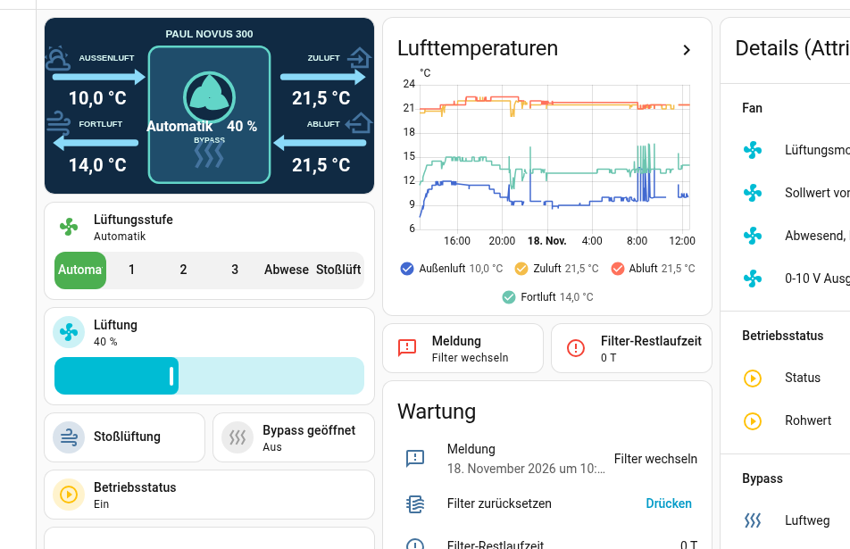
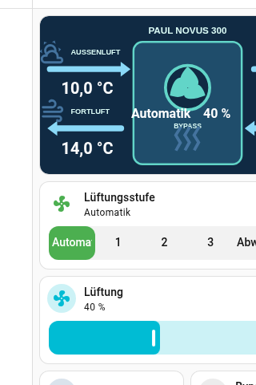

# Paul Novus 300 RS-485 Bus

[](https://github.com/BenPru/novus300_Rs485/actions/workflows/validate.yml)
[](https://github.com/BenPru/novus300_Rs485/actions/workflows/hassfest.yml)

[Deutsche Dokumentation](README.de.md)

> **XOR beta `2026.11.24b1`:** this branch adds a hardware/firmware profile
> selector and passive support for the protocol in [issue #10](https://github.com/BenPru/novus300_Rs485/issues/10).
> XOR is **read-only**, with an experimental selected-stage sensor (1-7),
> diagnostic pages and bus clock. Stages 1/2 are capture-confirmed; 3-7 are inferred.
> Boost, temperatures and write controls remain unsupported. Existing entries default to CRC16.
> [Beta installation and recording instructions](docs/DIAGNOSTICS.md#xor-beta-20261124b1).

Home Assistant integration for reading and controlling a Paul Novus 300
ventilation unit through its RS-485 bus. It exposes temperatures, operating
state, air path, filter and operating times, messages and the ventilation
mode, and (through the `socket://` bridge) switches the unit on/off and sets
mode, levels and clock.

An existing Tinkerforge Industrial Analog Out V2 can optionally be exposed as
`fan.novus300` to control the unit's external 0-10 V input. This output is
controllable only while the unit panel is in **Automatic** mode. The RS-485
connection reads continuously and, only through the `socket://` bridge
with the command whitelist enabled, can request a ventilation mode via
`select.novus300_ventilation_mode` (Automatic, levels 1–3, away, boost).

## Contents

- [Tested hardware and compatibility](#tested-hardware-and-compatibility)
- [Requirements](#requirements)
- [Install with HACS](#install-with-hacs)
- [Connect and configure RS-485](#connect-and-configure-rs-485)
- [Fan without 0-10 V](#fan-without-0-10-v)
- [Optional Tinkerforge 0-10 V fan control](#optional-tinkerforge-0-10-v-fan-control)
- [Options (settings dialog)](#options-settings-dialog)
- [Unit settings](#unit-settings)
- [Entities](#entities) · [Dashboard](#dashboard) · [Automation examples](#automation-examples)
- [Troubleshooting](#troubleshooting)
- [Report new hardware with diagnostics](docs/DIAGNOSTICS.md)
- [Passive bus capture preparation](#passive-bus-capture-preparation)
- [HACS](#hacs)
- [License](#license)
- [Clock synchronization](#clock-synchronization)
- [Bridge write protection](#bridge-write-protection)

## Tested hardware and compatibility

Status as of **2026-11-26**. These are tested combinations, **not a blanket
compatibility promise for every Novus of the same year**. Years are owner-reported;
the 2011 issue includes dated component labels. Select profiles by captured
protocol, not year or panel appearance alone.

| Unit / components | Bus and versions | Result |
|---|---|---|
| Novus 300, reported 2014, TFT panel `ETA0036E29A`, fan slave `SWZ0025B26A`, external PTC defroster `ST00064E24A`; bypass disabled | CRC16 reference profile; stable 2026.11.21 | **Positive live tests:** temperatures, operating data, mode feedback and controller response to HA stage changes. Panel synchronization remains unresolved; see limitations below. |
| Second Novus 300, reported 2014, TFT panel `ETA0036E30A`, installed bypass, no defroster | CRC16 reference profile; stable 2026.11.21 | **Positive live tests:** reception and decoded operating data. Bypass configuration/status decoding has been investigated; direct flap control is unsupported. |
| First-generation Novus 300, reported 2011, LED/button panel and ground heat exchanger; Waveshare RS232/485/422 TO POE ETH (B), firmware V1.523 | XOR framing; actual Novus HW/FW versions unknown; [issue #10](https://github.com/BenPru/novus300_Rs485/issues/10) | **Negative with CRC16**, including dynamic addresses. **Positive stage readback:** owner confirms all seven stages with XOR beta 2026.11.24b1; labelled captures independently reproduce stages 1/2. No temperatures or writes yet. |
| Novus 300 commissioned January 2019, **probably RD, not confirmed by type plate**; TFT no. 1 `ETA0036E31E`, master `SWZ0024B31A`, fan slave `SWZ0025B27A`, electric defroster `ST00064E26E`; no bypass/reheater/GHE; FTDI DSD TECH SH-U14 | CRC16; panel slot `04`, fan slave `08`, defroster `09`, free-slot poll `FF`; [issue #11](https://github.com/BenPru/novus300_Rs485/issues/11) | **Positive reception reported; all six captures replayed offline.** CRC16 beta 2026.11.26b1 fixes startup settings and selected automatic mode. **Stock mode writes do not work:** no slot `05`. Experimental external writes cause a full rebroadcast and ~15 s status sequence; not validated as harmless. |
| Other Novus 300/450 **RD (redesign)** combinations, from serial range `15000-2`, with RD LED or TFT controls | Protocol/firmware compatibility not established for other combinations | **Untested**, not a negative result. Do not infer universal compatibility from the probable-RD example above. |

`ETA...`, `SWZ...` and `ST...` above are component software identifiers, not
unit serial numbers. **The displayed `BUS 1.7.1` is static reference metadata,
not an independently detected bus firmware version.** CRC16/XOR describe the
observed framing/checksum, not numbered hardware revisions. A restored identity
alone does not prove that the component is present.

**Component limits / known negative results:** PTC presence and its software
identity have been observed, but a bus-only heating/standby/mains-off status has
not been established. An installed ground heat exchanger in issue #10 does not
establish support for its damper. Brine defrosters, reheaters and other
firmware combinations have no positive hardware test evidence here.
On the CRC16 reference unit, HA stage commands change controller feedback and
physical consumption, but the TFT can retain its previous selection and another
participant may later reassert it. Frost-setting changes are also not reliably
reflected on the panel; HA's parameter display alone is not device readback.
These limitations prevent a claim that all write functions are fully validated.

**Separate betas:** [2026.11.24b1](https://github.com/BenPru/novus300_Rs485/releases/tag/2026.11.24b1)
is the read-only LED/XOR beta.
[2026.11.26b1](https://github.com/BenPru/novus300_Rs485/releases/tag/2026.11.26b1)
on `beta/crc16-rd` is the CRC16/TFT beta, not an XOR update. It separates selected
mode (`0x29`) from applied mode (`0x27`), preserves boost as an overlay and
decodes startup settings after `0x2A`–`0x2D`. Both raw mode values appear in
diagnostics and are persisted. Before `0x29` has been observed, legacy `0x27`
feedback is retained; restored values are provisional, not fresh confirmation.
No measured-speed sensor is inferred from these mode bytes.

To try a beta: HACS → this integration → enable **Show beta versions** →
**Redownload** → select the exact version, then restart **Home Assistant only**.
For issue #11, keep the bridge **read-only** (no `--allow-command-frames`);
do not automate writes yet. This beta does not change the bridge, write slot,
parity, power-on frame or imbalance scale. The reference installation's
0.5 %/raw-step imbalance scale remains; issue #11's proposed 1 %/step needs
comparison with its panel. Stable/latest remains 2026.11.21.

### Newer revision: RD / redesign

Zehnder's [manual index](https://zehnder-systems-de.zendesk.com/hc/de/articles/4403739035793-Novus-300-450-Anleitungen)
separates service instructions **V1.0 through June 2015 / serial numbers up to
14999** from **V2.0 from October 2015 / serial range 15000-2 onward**. Its
[parts list](https://zehnder-systems-de.zendesk.com/hc/de/articles/4409158002705-Novus-Ersatzteilliste)
calls the newer hardware **RD (redesign)** and lists different master/slave
boards, BUS thermostats and both LED and TFT panels. RD replacement-part labels
are marked with a black bar.

| Panel spare part | Before RD | RD |
|---|---|---|
| LED/button panel | `521010730` | `521014130` |
| TFT touch panel | `521010740` | `521014140` |

These are **part numbers**, not firmware readings or evidence that panels can
be interchanged across families. Both documented families offer both panel types;
this does not prove availability for every year/firmware combination. The
2011 LED/XOR versus 2014 TFT/CRC16 difference could involve the panel, controller
firmware or their interaction; **“LED = XOR, TFT = CRC16” is not established**.
These are hardware/service distinctions,
**not proof of a different or compatible RS-485 protocol**; “V2.0” here is not
a bus firmware reading. Use the actual unit/board versions and a
[passive diagnostic capture](docs/DIAGNOSTICS.md) to establish compatibility.

## Requirements

- Home Assistant with HACS
- Paul Novus 300 with an accessible RS-485 service/bus connection
- A suitable RS-485 adapter, or a separate serial-to-TCP reader
- Optional for `fan.novus300`: a Tinkerforge Master/Bricklet setup with an
  **Industrial Analog Out V2**, Brick Daemon, and network access

> [!WARNING]
> Work on the ventilation unit and its bus wiring is at your own risk. Switch
> off the unit before connecting or altering any wiring. Always follow the
> connection pinout, permitted cable length, and termination guidance in the
> Paul documentation for the specific unit. CRC16 writes require the project's
> bus-aware bridge with its command whitelist; a generic transparent TCP
> converter is not an equivalent write scheduler. XOR remains read-only.

## Install with HACS

[](https://my.home-assistant.io/redirect/hacs_repository/?owner=BenPru&repository=novus300_Rs485&category=integration)
[](https://my.home-assistant.io/redirect/config_flow_start/?domain=novus300bus)

The first button opens this repository in HACS of your Home Assistant. Download
the integration and restart Home Assistant, then use the second button to start
its configuration. Both buttons use My Home Assistant.

Alternatively, install and configure it manually:

1. Open **HACS → Integrations**.
2. Select the three-dot menu and choose **Custom repositories**.
3. Add `https://github.com/BenPru/novus300_Rs485` with category
   **Integration**.
4. Download the integration and restart Home Assistant.
5. Go to **Settings → Devices & services → Add integration** and select
   **Paul Novus 300 RS-485 Bus**.

The RS-485 integration is configured entirely in the UI; YAML is not needed.

## Connect and configure RS-485

### Direct USB-to-RS-485 adapter

1. Use an adapter whose UART supports **MARK parity** at 9600 baud. In Home
   Assistant, use its stable `/dev/serial/by-id/...` path instead of
   `/dev/ttyUSB0`.
2. With the unit powered off, connect the adapter to the RS-485 interface
   specified for your ventilation unit:
   - adapter `A`/`D+` to unit `A`/`D+`;
   - adapter `B`/`D-` to unit `B`/`D-`;
   - connect signal ground only where the Paul wiring diagram specifies it.
3. Do not feed bus power or add termination resistors unless the unit
   documentation specifically requires this.
4. In the integration, select the `/dev/serial/by-id/...` path, **9600** baud,
   and **mark** parity.

If no readings arrive, first verify A/B against the unit documentation.
Wire colours are not standardized and must not be used to identify A and B.

### Serial over TCP

The RS-485 interface can instead be read by a separate computer and made
available as a TCP stream. This keeps the physical bus connection independent
of the Home Assistant host.

- The serial reader handles 9600 baud and MARK parity on its local UART.
- Enter `socket://<host>:<port>` in the integration, for example
  `socket://192.0.2.45:9700`.
- Select **none** parity in the integration because the serial reader already
  processed the parity.

The TCP reader must either accept only one client or serialize access. A
second concurrent connection can replace the Home Assistant connection.

## Fan without 0-10 V

`fan.novus300` is always available and shows the percentage of the active level. With 0-10 V enabled, setting a percentage selects automatic mode and writes it via Tinkerforge. If 0-10 V control is disabled, it controls the unit over the bus: a target below level 2 selects level 1 and sets its percentage to the target (min. 17 %), above level 2 it selects level 3 likewise; the target equal to level 2 selects level 2. The original level 1/3 percentages are stored and restored when the level is left (also after a restart).

## Optional Tinkerforge 0-10 V fan control

RS-485 monitoring works without Tinkerforge. This section is only required
for the additional `fan.novus300` entity.

### Prepare Tinkerforge

1. Connect the **Industrial Analog Out V2** to the Tinkerforge stack and find
   its UID in Brick Viewer.
2. Run Brick Daemon on the host/gateway that reaches the Tinkerforge stack.
   Its default port is `4223`.
3. Allow the Home Assistant host to reach `<tinkerforge-host>:4223`.
4. In the integration options, enable **0-10 V fan control** and enter the
   host, port, and UID.

### Connect the 0-10 V output

1. Switch off the ventilation unit and Tinkerforge hardware before wiring.
2. Connect `OUT` on the Industrial Analog Out V2 to the external **0-10 V
   control input** named in the Paul documentation.
3. Connect the analog output `GND` to the corresponding control-input signal
   ground. Never connect it to RS-485 A or B.
4. Verify allowed voltages, ground reference, and any required galvanic
   isolation in the unit documentation before powering up.
5. Test at 0% first, then use low values before increasing the output.

`fan.novus300` reads the existing analog voltage at startup. Writing is only
allowed while the unit panel is in **Automatic** mode. At panel levels 1–3,
boost, away, or standby, the entity is intentionally read-only.

When the configured automatic-mode helper exists, `fan.novus300` additionally
offers the **Automatic** and **Manual** presets. They toggle only that helper
and are also available only in panel Automatic mode. The
`button.novus300_boost` button requests the panel **boost** mode on the RS-485
bus and, after the configured duration, restores the previous mode if the unit
is still in boost.

## Options (settings dialog)

Open **Settings → Devices & services → Paul Novus 300 RS-485 Bus → gear icon**, then choose the settings group. General settings list values the unit has not broadcast yet. Saving writes unit settings over the bridge (command whitelist required).

| Field | What it does | Values / default |
|---|---|---|
| **Serial device / bridge URL** | RS-485 connection: a device path (`/dev/serial/by-id/...`) or `socket://host:port` of the serial bridge. Writing (mode, power, settings, clock) only works through the bridge started with `--allow-command-frames`. | `/dev/ttyNovus300` |
| **Baud rate** | Bus speed. | 9600 |
| **Parity** | Physical UART setting; `socket://` does not configure the remote converter. | Profile/adapter-specific: the reference write bridge uses MARK; issue #10 XOR reception uses 8N1. |
| **Accept dynamic bus addresses (experimental)** | During setup or under **Reconfigure → Interface: RS-485 bus**: also accepts CRC-valid receive frames with a different first header byte (previously only `00/01`). The second header byte is already unrestricted. Write destinations, bus timing and register decoding stay unchanged; no automatic device mapping. Not a confirmed fix for issue #10. | off |
| **Synchronize time daily** | Sets the unit's date and time to Home Assistant's time every day at 03:00 and checks the drift. | on |
| **Ventilation level 1 / 2 / 3 (%)** | Fan percentage of the three levels, written to the unit. Must satisfy 17 % ≤ level 1 < level 2 < level 3 ≤ 100 %, otherwise the dialog shows an error. Shows the original value even while a percentage temporarily overrides level 1 or 3. | 35 / 60 / 90 % |
| **Level 1 / 2 / 3: fan imbalance (%)** | Independent fine adjustment grouped with each level. Values are remembered from the bus; unknown values stay blank and are not written unless entered. | −50 to +50 %, step 0.5 |
| **Boost duration** | How long the boost level runs after `button.novus300_boost`. Dropdown in 5-minute steps (5–120). | 15 min |
| **Away: ventilation time (min/h)** | Ventilation minutes per hour at level 1 in away mode. | 15 / 30 / 45, default 30 |
| **Show levels instead of automatic when the fan is set by percentage** | Off: the mode select stays on *Automatic* while `fan.novus300` sets a percentage. On: it shows level 1 or 3. | off |
| **Filter interval** | Replacement interval written to the unit; used by the filter reset. Dropdown 30–180 days in 10-day steps. | 90 days |
| **0-10 V: Enable fan control** | Optional hardware path via a Tinkerforge Industrial Analog Out V2 (see below). Not needed for bus control. | off |
| **0-10 V: Tinkerforge host / port / UID** | Address of the Tinkerforge brick daemon and the UID of the analog out module. | `10.0.17.45` / 4223 / `Hob` |
| **0-10 V: Automatic mode helper entity** | `input_boolean` that marks automatic mode for the 0-10 V output. | `input_boolean.luftung_automatik` |

Notes:
- Values the unit sends itself (menu changes at the panel) are stored in the options automatically.
- Saving discards temporary level overrides set via the fan percentage and restores the original levels.
- Changing the filter interval also writes it to the unit.

## Unit settings

These values live in the unit. The ventilation levels are plain number fields
(17–100 %, increasing whole numbers); the durations are dropdowns:

| Setting | Unit step | Default |
|---|---|---:|
| Ventilation level 1 / 2 / 3 | whole percentages, 17–100 % | 35 / 60 / 90 % |
| Fan imbalance level 1 / 2 / 3 | −50 to +50 %, step 0.5 | read from unit; blank if unknown |
| Boost duration | 5 min | 15 min (factory) |
| Away: ventilation time | 15 / 30 / 45 min/h | 30 min/h |

The filter interval (30–180 days, 10-day steps) is a dropdown in the options; saving writes it to the unit. `button.novus300_filter_reset` and the `novus300bus.reset_filter` service reset the filter runtime (both registers set to the configured interval).

Saving general settings writes the level/duration values and supplied imbalance values over the RS-485 bridge. Update `tools/novus300_serial_bridge.py` on the bridge host for imbalance writes; the whitelist still rejects unrelated registers and invalid ranges.
The unit broadcasts them only rarely (one register every few minutes in a slow rotation, not right at start-up) and they are stored in the options automatically once seen; the integration remembers the values last
seen on the bus (when saved on the panel) and offers them as defaults. Boost and
away have no percentage on the panel. Boost has a duration; away is the
ventilation time per hour (min/h) at level 1 for moisture protection. `fan.novus300` uses
**Ventilation level 2** when turned on; the boost button runs the unit's boost
for the configured **Boost duration**. Standby and boost/away show the raw bus
value for the fan setpoint.

### Summer ventilation and bypass

Summer ventilation activation is `switch.novus300_summer_ventilation`, not a checkbox in the options. It is offered only when the configuration confirms **no bypass**; manual entity disabling is respected. With a bypass, the read-only bypass feedback is enabled instead. `switch.turn_on` / `switch.turn_off` can be used in automations. Only bit `0x80` in the known plant configuration is changed; unknown configuration or missing bus confirmation produces an error rather than a successful-looking state.

This enables the unit's summer-ventilation function; it **does not force the bypass flap open or closed**. `switch.novus300_bypass` remains read-only feedback. A verified direct actuation command is still missing, and physical flap movement has not been tested. Bypass installation and temperature thresholds remain in the options.

## Entities

A complete list with all attributes: [docs/ENTITIES.md](docs/ENTITIES.md).

### Dashboard

[`dashboards/novus300.yaml`](dashboards/novus300.yaml) is a ready-made dashboard (standard cards only, including a "Details (Attribute)" card and the status-change list). The graphic is served by the integration itself (at `/novus300bus/novus300-airflow.svg`); nothing has to be copied to `config/www/`. In short: create a new dashboard → raw configuration editor → paste the file's content. **Detailed step-by-step guide (variants, checks, troubleshooting): [docs/DASHBOARD.md](docs/DASHBOARD.md).**

It includes **Übersicht** (controls and airflow) and **Sensoren** (second plant diagram with sensor positions and equipment-dependent overlays). The guide also explains a second **editable UI dashboard** alongside the YAML dashboard and why both copies need updating separately.



The mode buttons highlight the active level; the boost, message and filter tiles are coloured only when they apply:



Entities used (all provided by this integration): `select.novus300_ventilation_mode`, `fan.novus300`, `button.novus300_boost`, `switch.novus300_power`, `switch.novus300_bypass`, `sensor.novus300_message`, `button.novus300_filter_reset` and the temperature and filter sensors.

#### Automation examples

```yaml
# Boost when the bathroom humidity is high
automation:
  - alias: "Novus: boost on high humidity"
    triggers:
      - trigger: numeric_state
        entity_id: sensor.bathroom_humidity
        above: 70
    actions:
      - action: button.press
        target:
          entity_id: button.novus300_boost

# Set level 2 when nobody is home away, automatic when home
  - alias: "Novus: level by presence"
    triggers:
      - trigger: state
        entity_id: group.family
    actions:
      - action: select.select_option
        target:
          entity_id: select.novus300_ventilation_mode
        data:
          option: "{{ 'away' if is_state('group.family', 'not_home') else 'automatic' }}"

# Fan speed in percent (bus mode, level 1/3 is overridden temporarily)
  - alias: "Novus: 45 % in the evening"
    triggers:
      - trigger: time
        at: "18:00:00"
    actions:
      - action: fan.set_percentage
        target:
          entity_id: fan.novus300
        data:
          percentage: 45

# Notify about unit messages
  - alias: "Novus: message"
    triggers:
      - trigger: state
        entity_id: sensor.novus300_message
    conditions:
      - "{{ trigger.to_state.state not in ['Keine Meldung', 'unavailable'] }}"
    actions:
      - action: notify.notify
        data:
          message: "Novus 300: {{ trigger.to_state.state }}"

# Activate summer ventilation by schedule (only without a configured bypass)
  - alias: "Novus: summer ventilation in the evening"
    triggers:
      - trigger: time
        at: "21:00:00"
    conditions:
      - condition: state
        entity_id: switch.novus300_summer_ventilation
        state: "off"
    actions:
      - action: switch.turn_on
        target:
          entity_id: switch.novus300_summer_ventilation
```

After changing the filter, press `button.novus300_filter_reset` (or call `novus300bus.reset_filter`).

#### Option: real fan levels

By default the mode select stays on **Automatic** while a fan percentage is active. Enable **Show levels instead of automatic when the fan is set by percentage** (`show_fan_levels`) in the integration options to show level 1/3 instead.

Selecting a level **in Home Assistant** requests restoration of the original
percentages, even when reselecting the current level. A mode change reported
by the physical panel also triggers restoration of the now-inactive temporary
level. Pressing the already-active panel level again does not currently trigger
restoration; existing captures do not unambiguously establish that action.

On a reported restore write failure, the original is retained and a later
coordinator update retries after a 60-second backoff. Stage-percentage writes
do not wait for unit readback: a successful send is **not a guarantee** that
the unit has physically applied the original value.


- supply, outdoor, extract, and exhaust air temperatures
- `select.novus300_ventilation_mode` to show and set automatic, levels 1–3,
  away, and boost
- `switch.novus300_power` ("Betriebsstatus") to switch the unit on/off and show the run state, and `switch.novus300_bypass` (read-only bypass state)
- operating time, fan operating time, filter interval, and remaining filter
  time when the controller broadcasts its complete register dump
- `sensor.novus300_message` with the current unit message (e.g. filter change) and `previous_message*` attributes with the unit's last three messages, `occurred_at` with when the latest occurred (sent only when the unit starts up, then stored)
- optional `fan.novus300` and `button.novus300_boost`

Not every register is sent continuously. After a Home Assistant restart, you
may need to change the panel level once for the current mode to be broadcast
again.

## Troubleshooting

| Symptom | Check |
|---|---|
| No RS-485 readings | Verify the stable `/dev/serial/by-id/...` path, 9600 baud, MARK parity, and A/B wiring. |
| TCP connection drops | Ensure only one client is connected to the serial TCP reader. |
| `fan.novus300` cannot be controlled | Set the panel to Automatic and verify Tinkerforge host, port, UID, and Brick Daemon. |
| Fixed panel level has the wrong percentage | Adjust the matching Ventilation level option; it is written to the unit. |
| Filter or operating time is missing | Wait for the unit's complete register dump; these registers are not broadcast continuously. |

To help identify values from another unit or accessories such as an EWT damper,
follow the [diagnostic collection and GitHub issue guide](docs/DIAGNOSTICS.md).
It covers timestamped panel actions, downloads, the rolling raw log and privacy.

## Passive bus capture preparation

The receive-only capture utility and its later operating procedure are in
[docs/full-duplex-capture.md](docs/full-duplex-capture.md). It is installed
but inactive on the bridge host and must only be started for a planned,
documented recording session.

## HACS

This repository is ready to be added as a custom HACS repository. It includes
one integration, a root `hacs.json`, the required integration manifest, a
brand icon, a GPL-3.0-only license, and HACS and Hassfest validation workflows.

The repository is already listed alphabetically in the official
[hacs/default integration list](https://github.com/hacs/default/blob/master/integration).
Release [2026.11.2](https://github.com/BenPru/novus300_Rs485/releases/tag/2026.11.2)
is available after successful HACS and Hassfest validation. HACS will discover
the release during its next scheduled scan; no additional catalog pull request
is necessary.

## License

This project is licensed under [GPL-3.0-only](LICENSE).

## Clock synchronization

The option **Synchronize time daily** (on by default) sets the unit's date and
time to Home Assistant's local time every day at 03:00 and verifies the result
from the unit's clock broadcast. It requires the `socket://` bridge.

## Bridge write protection

`tools/novus300_serial_bridge.py` forwards only known ventilation-mode frames
power frames (off/on) and valid clock and setting frames (CRC and value range checked), sent in the
panel's bus slot. Start it with `--allow-command-frames` to enable writing.
