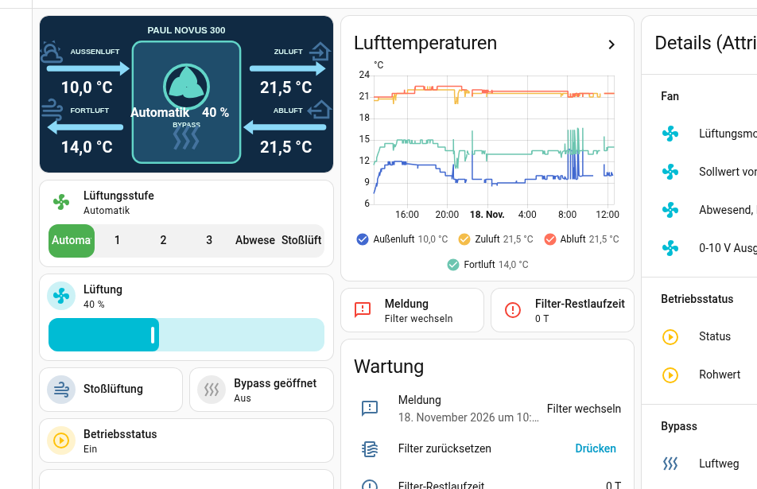

# Dashboard installieren

Das mitgelieferte Dashboard enthält **zwei Ansichten**, nur mit Standardkarten. Zusätzliche HACS-Frontend-Karten sind nicht nötig.

| Ansicht | Pfad innerhalb des Dashboards | Inhalt |
| --- | --- | --- |
| Übersicht | `novus300` | Luftstromschema mit vier Temperaturen, Modus/Stufe/Stoßlüftung/Power, Bypass-Rückmeldung, Sommerlüftung, Meldungen, Filterwartung, Details und Statuswechsel. |
| Sensoren | `novus300-sensoren` | Zweites, kompaktes Anlagenschema mit Temperaturen an den Sensorpositionen, Betriebsmodus, Lüfterprozent, Bypass-Stellung und anklickbaren Meldungs-/Filterindikatoren. |

Die zweite Ansicht oben über **Sensoren** öffnen. Sie ist in derselben YAML-Datei enthalten und muss nicht separat heruntergeladen werden.



## Voraussetzungen

- Die Integration ist eingerichtet und die Entitäten `sensor.novus300_*`, `select.novus300_ventilation_mode`, `fan.novus300` usw. sind vorhanden (Einstellungen → Geräte & Dienste → Paul Novus 300 → Entitäten).
- Die Grafik `novus300-airflow.svg` wird **von der Integration selbst** unter `/novus300bus/novus300-airflow.svg` ausgeliefert. Sie muss **nicht** mehr nach `config/www/` kopiert werden. Nach einem Update der Integration ist ein Neustart von Home Assistant nötig.
- Die Sensoransicht nutzt `novus300-base.svg` mit transparenten Ebenen `novus300-reheater.svg`, `novus300-ewt.svg`, `novus300-brine.svg`, `novus300-bypass.svg` und `novus300-defroster.svg` unter demselben URL-Präfix. Die alte `novus300-schema.svg` wird nicht mehr ausgeliefert.
- Die Ebenen verwenden die Attribute `bypass_present`, `reheater_present`, `ewt_present`, `defroster_present` und `brine_defroster_present` von `fan.novus300`. Bestätigt nicht vorhandene Teile werden ausgeblendet; bei unbekannter Ausstattung kann eine Ebene bis zum Empfang der Werte sichtbar bleiben. Separate Ausstattungs-Binärsensoren werden nicht mehr verwendet.
- Sommerlüftung erscheint nur bei nutzbarem Zustand von `switch.novus300_summer_ventilation` und bestätigtem Bypass. **Bypass geöffnet** ist ausschließlich eine Rückmeldung, keine manuelle Klappensteuerung.

## Variante A: Eigenes Dashboard in der Oberfläche (empfohlen)

1. **Einstellungen → Dashboards → Dashboard hinzufügen** (unten rechts).
2. **Neues Dashboard von Grund auf** wählen, Titel z. B. „Lüftung" eingeben, **Erstellen**.
3. Das neue Dashboard in der Seitenleiste öffnen.
4. Oben rechts auf den **Stift** (Bearbeiten) klicken. Beim ersten Mal „Dashboard selbst verwalten" bestätigen.
5. Oben rechts auf **⋮ → Rohkonfigurationseditor** klicken.
6. **Den gesamten vorhandenen Inhalt löschen** (Strg+A, Entf).
7. Den kompletten Inhalt von [`dashboards/novus300.yaml`](../dashboards/novus300.yaml) einfügen (auf GitHub: Schaltfläche „Copy raw file").
8. **Speichern**, Editor schließen, Bearbeitung beenden (Häkchen).

## Variante B: Als YAML-Datei einbinden

1. Die Datei `novus300.yaml` nach `config/dashboards/novus300.yaml` kopieren (Ordner anlegen, falls nötig).
2. In `configuration.yaml` ergänzen:

   ```yaml
   lovelace:
     dashboards:
       novus300-yaml:
         mode: yaml
         title: Lüftung
         icon: mdi:fan
         show_in_sidebar: true
         filename: dashboards/novus300.yaml
   ```

3. Home Assistant neu starten. Das Dashboard erscheint in der Seitenleiste. Änderungen an der Datei wirken nach dem Neuladen der Browserseite.

## YAML-Dashboard und zweites editierbares Dashboard

Beide Varianten können parallel bestehen: Das YAML-Dashboard bleibt die gepflegte Vorlage; zusätzlich nach Variante A ein zweites UI-Dashboard **Lüftung (editierbar)** anlegen. Beide enthalten **Übersicht** und **Sensoren**. Auf der Anlage des Autors liegt die editierbare Kopie unter `/novus300-editable/novus300`, die Sensoransicht unter `/novus300-editable/novus300-sensoren`. Auf anderen Installationen ist die Dashboard-URL frei wählbar.

Home Assistant speichert die UI-Kopie unabhängig; sie lässt sich im visuellen Editor bearbeiten. Ein Update von `config/dashboards/novus300.yaml`, HACS oder der Integration **aktualisiert diese Kopie nicht**. Zum Aktualisieren eigene Anpassungen mit der neuen Vorlage vergleichen, die Rohkonfiguration sichern und gewünschte Änderungen im Roheditor zusammenführen. Ein angepasstes Dashboard nicht ungeprüft überschreiben. Umgekehrt verändern UI-Anpassungen die YAML-Datei nicht.

Nach einem Integrationsupdate Home Assistant für neuen Code und Grafiken neu starten, YAML-Vorlage und/oder UI-Kopie separat aktualisieren und bei alten Grafiken den Browser hart neu laden.

## Variante C: Als Ansicht in ein bestehendes Dashboard

Im Rohkonfigurationseditor des bestehenden Dashboards (Schritte 4–5 oben) beide Listeneinträge unter `views:` aus `novus300.yaml` (ab `- title: Übersicht`, einschließlich `Sensoren`) an die vorhandene `views:`-Liste anhängen. Die Einrückung muss dabei zur bestehenden Liste passen.

## Prüfen

- Das Schema mit der Grafik und den Temperaturen erscheint. Ist die Grafik leer, im Browser `http://<ha-adresse>:8123/novus300bus/novus300-airflow.svg` öffnen. Es muss ein Bild erscheinen. Andernfalls wurde Home Assistant nach dem Update nicht neu gestartet.
- Karten mit „Entität nicht verfügbar" zeigen auf Entitäten, die es bei dir nicht gibt. Siehe nächster Abschnitt.

## Entitäts-IDs anpassen

Das Dashboard verwendet die Standard-IDs, die die Integration vergibt (`sensor.novus300_supply_air_temperature` usw.). Wurden Entitäten umbenannt oder bei einer älteren Installation anders vergeben, im Rohkonfigurationseditor mit **Suchen und Ersetzen** (im Editor Strg+H, sonst Texteditor vor dem Einfügen) die ID ersetzen. Die tatsächlichen IDs stehen unter Einstellungen → Geräte & Dienste → Paul Novus 300 → Entitäten.

Verwendete Entitäten: `select.novus300_ventilation_mode`, `fan.novus300`, `button.novus300_boost`, `switch.novus300_power`, `switch.novus300_bypass`, `switch.novus300_summer_ventilation`, `sensor.novus300_message`, `button.novus300_filter_reset` sowie die Temperatur- und Filtersensoren.

## Häufige Probleme

| Problem | Ursache / Lösung |
| --- | --- |
| „Rohkonfigurationseditor" fehlt im Menü | Das Dashboard wird automatisch verwaltet. Im Bearbeiten-Modus zuerst „Dashboard selbst verwalten" bestätigen. |
| Fehler „Konfiguration ungültig" beim Speichern | Alter Inhalt nicht vollständig gelöscht oder falsch eingerückt eingefügt. Editor leeren und erneut einfügen. |
| Grafik fehlt, Rest funktioniert | Home Assistant nach dem Integrations-Update neu starten. Danach Browser-Cache leeren (Strg+F5). |
| Alle Karten „nicht verfügbar" | Integration nicht geladen oder Entitäts-IDs abweichend (siehe oben). |
| Alte Anleitung: Datei in `config/www/` kopiert | Nicht mehr nötig. Die Kopie in `www/` kann gelöscht werden. |
