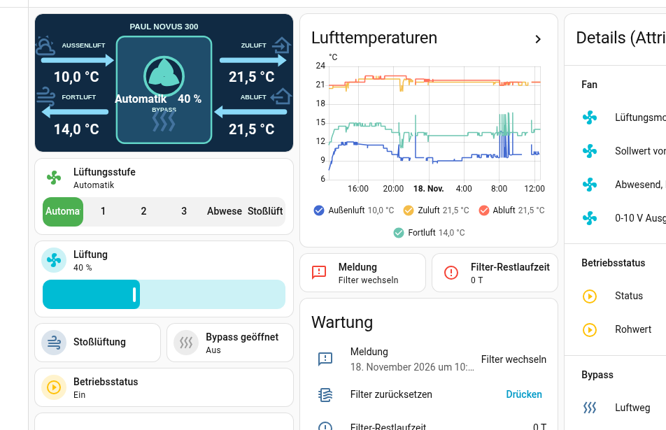

# Installing the dashboard

The bundled dashboard contains **two views**, using standard cards only; no extra HACS frontend cards are needed.

| View | Path within the dashboard | Contents |
| --- | --- | --- |
| Übersicht (overview) | `novus300` | Airflow diagram with four temperatures, mode/level/boost/power controls, bypass feedback, summer ventilation, messages, filter maintenance, details and status changes. |
| Sensoren (sensors) | `novus300-sensoren` | A second, compact plant diagram with temperatures at their sensor positions, operating mode, fan percentage, bypass position and clickable message/filter indicators. |

Select **Sensoren** in the top navigation to open the second view. It is included in the same YAML file, not a separate download.



## Prerequisites

- The integration is set up and the entities `sensor.novus300_*`, `select.novus300_ventilation_mode`, `fan.novus300`, etc. exist (Settings → Devices & services → Paul Novus 300 → Entities).
- The graphic `novus300-airflow.svg` is **served by the integration itself** at `/novus300bus/novus300-airflow.svg`. It no longer has to be copied to `config/www/`. Restart Home Assistant after updating the integration.
- The sensors view uses `novus300-base.svg` plus transparent overlays `novus300-reheater.svg`, `novus300-ewt.svg`, `novus300-brine.svg`, `novus300-bypass.svg` and `novus300-defroster.svg`, served at the same URL prefix. The old `novus300-schema.svg` is no longer shipped.
- Overlays use the `bypass_present`, `reheater_present`, `ewt_present`, `defroster_present` and `brine_defroster_present` attributes of `fan.novus300`. Parts confirmed absent are hidden; unknown installation values may still show an overlay until received. Separate installed-part binary sensors are no longer used.
- Summer ventilation is shown only while `switch.novus300_summer_ventilation` has a usable state and a bypass is confirmed. **Bypass open** is feedback only, not a manual flap control.

## Option A: Own dashboard in the UI (recommended)

1. **Settings → Dashboards → Add dashboard** (bottom right).
2. Choose **New dashboard from scratch**, enter a title such as "Ventilation", click **Create**.
3. Open the new dashboard from the sidebar.
4. Click the **pencil** (edit) at the top right. The first time, confirm "Take control".
5. Click **⋮ → Raw configuration editor** at the top right.
6. **Delete all existing content** (Ctrl+A, Delete).
7. Paste the complete content of [`dashboards/novus300.yaml`](../dashboards/novus300.yaml) (on GitHub: "Copy raw file").
8. **Save**, close the editor, finish editing (check mark).

## Option B: As a YAML file

1. Copy `novus300.yaml` to `config/dashboards/novus300.yaml` (create the folder if needed).
2. Add to `configuration.yaml`:

   ```yaml
   lovelace:
     dashboards:
       novus300-yaml:
         mode: yaml
         title: Ventilation
         icon: mdi:fan
         show_in_sidebar: true
         filename: dashboards/novus300.yaml
   ```

3. Restart Home Assistant. The dashboard appears in the sidebar. Changes to the file take effect after reloading the browser page.

## YAML dashboard and a second editable dashboard

Both variants can coexist: keep the YAML version as the maintained template and create a second UI dashboard called **Ventilation (editable)** using option A. Both contain the views **Übersicht** and **Sensoren**. On the author's installation, the editable copy is at `/novus300-editable/novus300`; the sensors view is `/novus300-editable/novus300-sensoren`. Other installations choose their own dashboard URL.

The UI copy is stored independently by Home Assistant and can be changed with the visual editor. Updating `config/dashboards/novus300.yaml`, HACS or the integration **does not update this copy**. To update it, compare your customizations with the new template, back up its raw configuration and merge the desired changes in the raw editor. Do not overwrite a customized dashboard blindly. Conversely, UI changes do not modify the YAML file.

After an integration update, restart Home Assistant to load the new code and graphics, update the YAML template and/or UI copy separately, and hard-refresh the browser if old graphics remain.

## Option C: As a view in an existing dashboard

In the raw configuration editor of the existing dashboard (steps 4–5 above), append both list entries below `views:` from `novus300.yaml` (starting at `- title: Übersicht`, including `Sensoren`) to the existing `views:` list. The indentation must match the existing list.

## Checking

- The diagram with the graphic and temperatures appears. If the graphic is empty, open `http://<ha-address>:8123/novus300bus/novus300-airflow.svg` in the browser. An image must appear; otherwise Home Assistant was not restarted after the update.
- Cards showing "Entity not available" point to entities that do not exist on your system. See the next section.

## Adjusting entity IDs

The dashboard uses the default IDs the integration assigns (`sensor.novus300_supply_air_temperature`, etc.). If entities were renamed or got different IDs on an older installation, use find and replace (Ctrl+H in the editor, or a text editor before pasting). The actual IDs are listed under Settings → Devices & services → Paul Novus 300 → Entities.

Entities used: `select.novus300_ventilation_mode`, `fan.novus300`, `button.novus300_boost`, `switch.novus300_power`, `switch.novus300_bypass`, `switch.novus300_summer_ventilation`, `sensor.novus300_message`, `button.novus300_filter_reset` and the temperature and filter sensors.

## Common problems

| Problem | Cause / fix |
| --- | --- |
| "Raw configuration editor" missing from the menu | The dashboard is auto-managed. In edit mode, first confirm "Take control". |
| "Invalid configuration" when saving | Old content not fully removed or pasted with wrong indentation. Clear the editor and paste again. |
| Graphic missing, rest works | Restart Home Assistant after the integration update, then hard-reload the browser (Ctrl+F5). |
| All cards "unavailable" | Integration not loaded, or entity IDs differ (see above). |
| Old instructions: file copied to `config/www/` | No longer needed. The copy in `www/` can be deleted. |
